# Лаба 4 — Репликация базы данных: подними, сломай, восстанови

**Авторы:** Чурилина Полина Олеговна, Арбузина Елена Романовна
**Группа:** К3320
**Репозиторий:** https://github.com/churilina-polina/ict-administration → папка `lab_4/`

---

## О чём лаба

Есть маленький сервис, который пишет заметки в базу и читает их обратно. Чтений становится много, поэтому читающую часть уводим на **реплику**. Задача: поднять репликацию, подключить к ней сервис (запись — в primary, чтение — с реплики), а потом ручками увидеть то, о чём была лекция: **отставание реплики (replication lag)**, его связь с **теоремой CAP** и что происходит при **отказе primary (failover)**. Плюс обязательный мониторинг.

Сервис тут вспомогательный, главное — работа devops *вокруг* базы: репликация, failover и мониторинг.

---

## Часть 0 — Какую СУБД выбрали и почему

Выбрали **PostgreSQL**.

Из двух вариантов (PostgreSQL / MongoDB) мы взяли Postgres, потому что:
- репликацию здесь надо **настраивать ручками через конфигурацию** — понимаешь, из чего она состоит (WAL, слоты, `pg_basebackup`, `pg_hba.conf`), а не получаешь её «из коробки»;
- failover **ручной** — приходится самим повысить реплику и переключить на неё сервис, и хорошо видно каждый шаг и каждую поломку по дороге;
- по лекции Postgres у нас «источник истины» (заказы, оплаты), так что с ним на практике ближе всего к реальной эксплуатации.

В MongoDB выборы нового primary происходят автоматически, и мы бы увидели меньше «внутренностей».

---

## Структура репозитория

```
lab_4/
├── docker-compose.yml             ← поднимает весь стенд одной командой
├── postgres/
│   ├── primary/01-init.sh         ← при первом старте primary: роли, таблица, права, pg_hba
│   └── standby/entrypoint.sh      ← при первом старте реплики: pg_basebackup с primary
├── app/                           ← подопытный сервис: запись → primary, чтение → реплика
│   ├── app.py
│   ├── requirements.txt
│   └── Dockerfile
├── postgres-exporter/queries.yaml ← свои метрики репликации для экспортера
├── prometheus/
│   ├── prometheus.yml
│   └── alert.rules.yml
├── alertmanager/alertmanager.yml
├── grafana/provisioning/          ← Grafana настраивает себя сама при старте
│   ├── datasources/datasources.yml
│   └── dashboards/{dashboards.yml, postgres-dashboard.json}
└── images/                        ← скриншоты для этого отчёта
```

### Из чего собран стенд

| Контейнер | Образ | Порт на localhost | За что отвечает |
|---|---|---|---|
| `primary` | `postgres:16` | 5432 | главный узел: принимает записи, отдаёт WAL реплике |
| `standby` | `postgres:16` | 5433 | реплика: streaming replication, доступна на чтение (hot standby) |
| `app` | собираем из `./app` | 8020 | подопытный сервис с кнопками |
| `exporter-primary` | `postgres-exporter:v0.17.1` | 9187 | метрики узла `primary` в формате Prometheus |
| `exporter-standby` | `postgres-exporter:v0.17.1` | 9188 | метрики узла `standby` |
| `prometheus` | `prom/prometheus:v3.1.0` | 9095 | собирает метрики, проверяет правила алертов |
| `alertmanager` | `prom/alertmanager:v0.28.0` | 9096 | принимает сработавшие алерты |
| `webhook` | `mendhak/http-https-echo` | 8083 | приёмник уведомлений (для проверки) |
| `grafana` | `grafana/grafana:11.4.0` | 3002 | дашборд |

> Порты у lab_4 «соседние»: стандартные 3000/9090/9091/8000… заняты стендами lab_2 и lab_3, которые тоже крутятся локально.

---

## Как запустить

```bash
cd lab_4
docker compose up -d --build
docker compose ps
```

Первый раз собирается пару минут. Все контейнеры должны быть `Up`, а `primary` и `standby` — `healthy`.

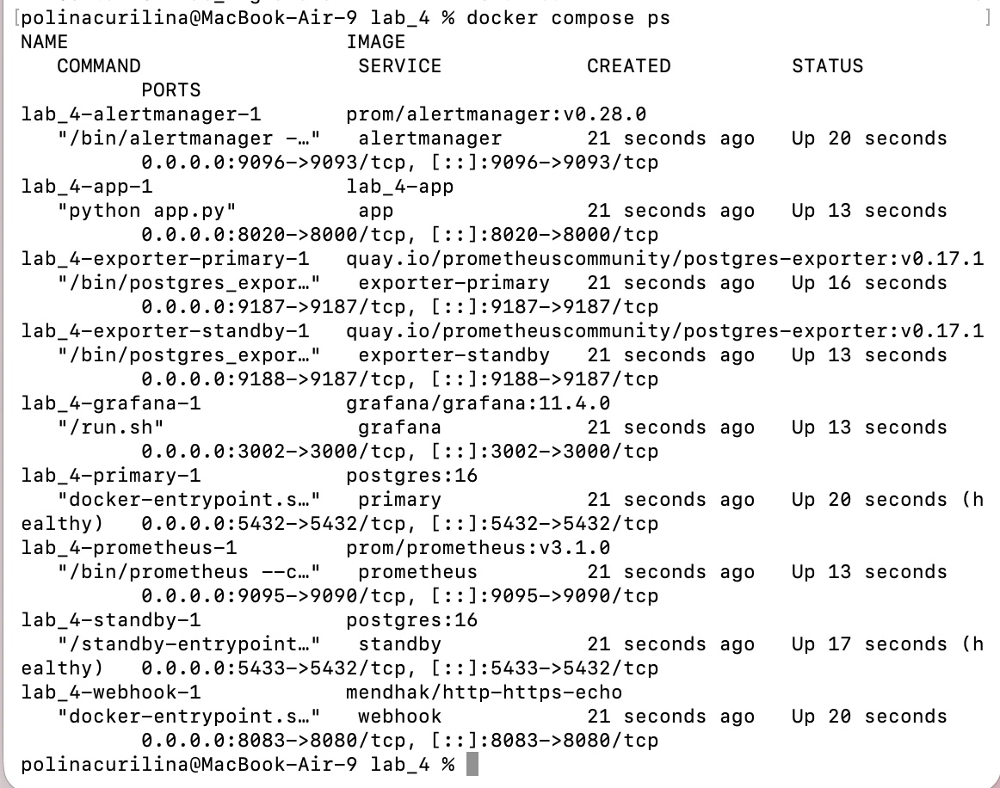

Веб-интерфейсы: сервис — http://localhost:8020, Grafana — http://localhost:3002, Prometheus — http://localhost:9095, Alertmanager — http://localhost:9096.

Остановить всё вместе с данными: `docker compose down -v` (без `-v` данные БД останутся в томах).

---

## Часть 1 — Репликация через конфигурацию

Всё поднимается декларативно, из `docker-compose.yml`. Вручную мы не выполняем ни одной команды в контейнерах: единственный «ручной» по сути шаг — `pg_basebackup` — спрятан в `postgres/standby/entrypoint.sh` и запускается сам при первом старте реплики.

### Как это устроено

Репликация в Postgres — это **передача журнала WAL** (write-ahead log, в него пишется каждое изменение) с primary на реплику, где эти изменения повторно применяются. Для этого нужно:

**1. Настроить primary** (флаги `-c` в `command` сервиса `primary`):

```yaml
- wal_level=replica          # писать в WAL достаточно информации для репликации
- max_wal_senders=10         # сколько потоков WAL к репликам разрешено
- max_replication_slots=10   # слоты репликации
- synchronous_standby_names= # пусто = асинхронная репликация
```

**2. Завести пользователей** (`postgres/primary/01-init.sh`, выполняется один раз при создании тома). Принцип наименьших привилегий из лекции — у каждого свой пользователь и только нужные права:

| Пользователь | Права | Для чего |
|---|---|---|
| `replicator` | `REPLICATION` | только скачивать WAL и делать базовую копию |
| `exporter` | роль `pg_monitor` | экспортер читает статистику, больше ничего |
| `app` | `SELECT, INSERT` на `notes` + `pg_read_all_stats` | сервис; читать статистику репликации ему нужно, чтобы показывать лаг на странице |

**3. Разрешить подключение реплики в `pg_hba.conf`.** По умолчанию пользователь не может подключаться к «виртуальной» базе `replication` — строчка `host replication replicator all scram-sha-256` добавляется тем же init-скриптом.

**4. Снять базовую копию и запустить реплику** (`postgres/standby/entrypoint.sh`):

```bash
pg_basebackup -h primary -U replicator -D "$PGDATA" -R -X stream -C -S standby1
```

- `-R` — pg_basebackup сам кладёт файл `standby.signal` («этот узел — реплика») и `primary_conninfo` (откуда тянуть WAL);
- `-X stream` — тянуть WAL, пока идёт копирование;
- `-C -S standby1` — создать **physical replication slot**: primary не выбросит WAL, который реплика ещё не получила (если реплика отстала или перезапускается).

**5. Включить чтение на реплике** — `hot_standby=on`. Без него реплика не принимает даже `SELECT`.

### Проверяем, что репликация работает

На primary в `pg_stat_replication` должен появиться подключённый `standby1` в состоянии `streaming`, а `pg_is_in_recovery()` должно различать узлы (`f` у primary, `t` у реплики):

```bash
docker compose exec primary psql -U postgres -d notes -c "SELECT application_name, state, sync_state FROM pg_stat_replication;"
docker compose exec primary psql -U postgres -d notes -c "SELECT pg_is_in_recovery() AS primary_in_recovery;"
docker compose exec standby psql -U postgres -d notes -c "SELECT pg_is_in_recovery() AS standby_in_recovery;"
```

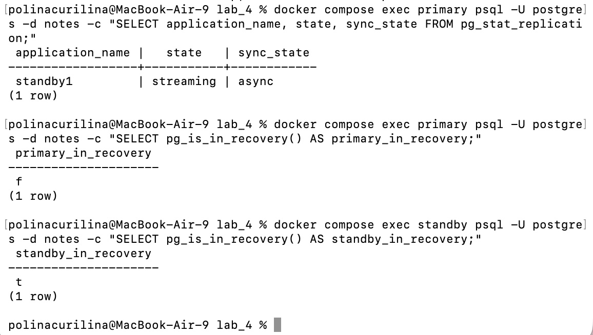

Реплика доступна только на чтение — запись в неё Postgres не принимает:

```bash
docker compose exec standby psql -U postgres -d notes -c "INSERT INTO notes(title, body) VALUES ('пишу в реплику', 'не получится');"
```

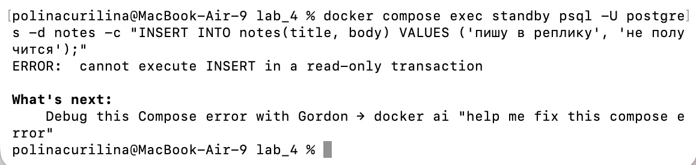

И главное — данные, записанные в primary, появляются на реплике:

```bash
docker compose exec primary psql -U postgres -d notes -c "INSERT INTO notes(title, body) VALUES ('привет из primary', 'проверка репликации') RETURNING id, title;"
docker compose exec standby psql -U postgres -d notes -c "SELECT id, title FROM notes ORDER BY id DESC LIMIT 3;"
```

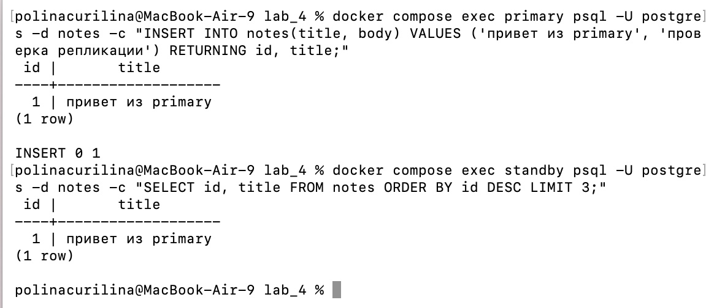

---

## Часть 2 — Подопытный сервис (read/write splitting)

Сервис на Python + Flask (`app/app.py`), свой Dockerfile. Адреса primary и реплики вынесены в переменные окружения — так удобно переключать при failover:

```yaml
environment:
  PRIMARY_HOST: primary   # сюда идут записи
  REPLICA_HOST: standby   # отсюда идёт чтение
  DB_NAME: notes
  DB_USER: app
```

Что умеет страница:
- **«Создать запись»** — `INSERT` в **primary**;
- **«Налить нагрузку»** — в фоне льёт в primary пачки по 30 записей (каждая пачка — отдельный коммит), всего 3000;
- список **«Записи»** (последние 15) и счётчик на реплике — чтение **с реплики**;
- сверху — сколько записей в primary и сколько видно на реплике, их разница (**отставание в записях**), и строка из `pg_stat_replication` (лаг в байтах WAL и `replay_lag` в секундах);
- ссылка «Автообновление (1 с)» — чтобы можно было не жать F5 и смотреть лаг в динамике (после «Налить нагрузку» страница включает её сама).

Соединения каждый раз открываются заново (без пула) — для лабы нормально; в проде тут стоял бы PgBouncer, как в лекции.

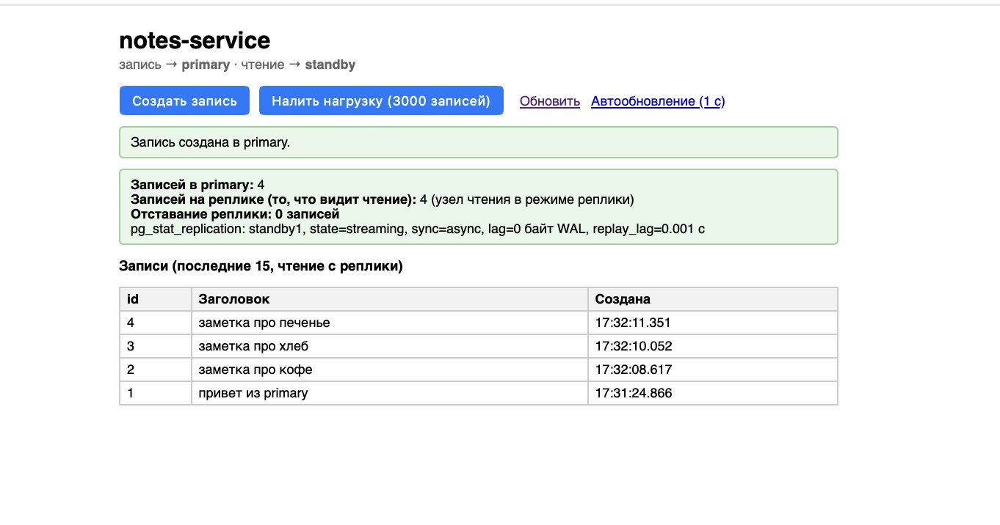

---

## Часть 3 — Ловим replication lag

### Сначала: на локальной машине лага почти нет

Сначала мы честно нажали «Налить нагрузку» на настройках «по умолчанию». Primary и реплика — два контейнера на одном компьютере, сеть между ними — виртуальная, WAL применяется за миллисекунды. При частом опросе страницы удавалось поймать разницу максимум в **одну пачку (≈30 записей)**, и то не всегда: через долю секунды цифры снова совпадали. Сфотографировать такое нереально, а чтобы «увидеть лаг» (и чтобы он вообще был виден в мониторинге), нужен лаг побольше.

В продакшене он возникает сам: реплика слабее primary, между ними настоящая сеть, на реплике идут тяжёлые SELECT'ы, идёт массовая запись. Чтобы воспроизвести это локально, мы воспользовались штатной настройкой Postgres — **задержанной репликой** (`recovery_min_apply_delay`): реплика получает WAL сразу, но применяет его только через N секунд. Это настоящая рабочая фича (задержанную реплику держат, например, как защиту от случайного `DROP TABLE` — до применения ещё можно успеть остановиться), а для нас — «регулятор лага».

В `docker-compose.yml`, у сервиса `standby`:

```yaml
- recovery_min_apply_delay=5s   # было 0
```

и `docker compose up -d` (пересоздастся только реплика).

### Что мы увидели

Включили автообновление страницы, нажали «Налить нагрузку» и стали смотреть. Первые секунды в primary записи уже есть, а **на реплике их ровно 0**. Потом реплика начинает догонять пачками (пример одного прогона, страница опрашивалась раз в секунду):

| время | записей в primary | записей на реплике | отставание |
|---|---|---|---|
| +1 с | 30 | 0 | 30 |
| +2 с | 1440 | 0 | 1440 |
| +3 с | 2820 | 0 | 2820 |
| +4 с | 3000 | 0 | 3000 |
| +6 с | 3000 | 330 | 2670 |
| +7 с | 3000 | 1770 | 1230 |
| +8 с | 3000 | 3000 | 0 |

Страница в этот момент выглядит так (до этого уже были другие нагрузки, поэтому цифры большие, важна разница): primary уже знает про все записи, а читающий запрос с реплики про последние 3000 ещё ничего не знает:

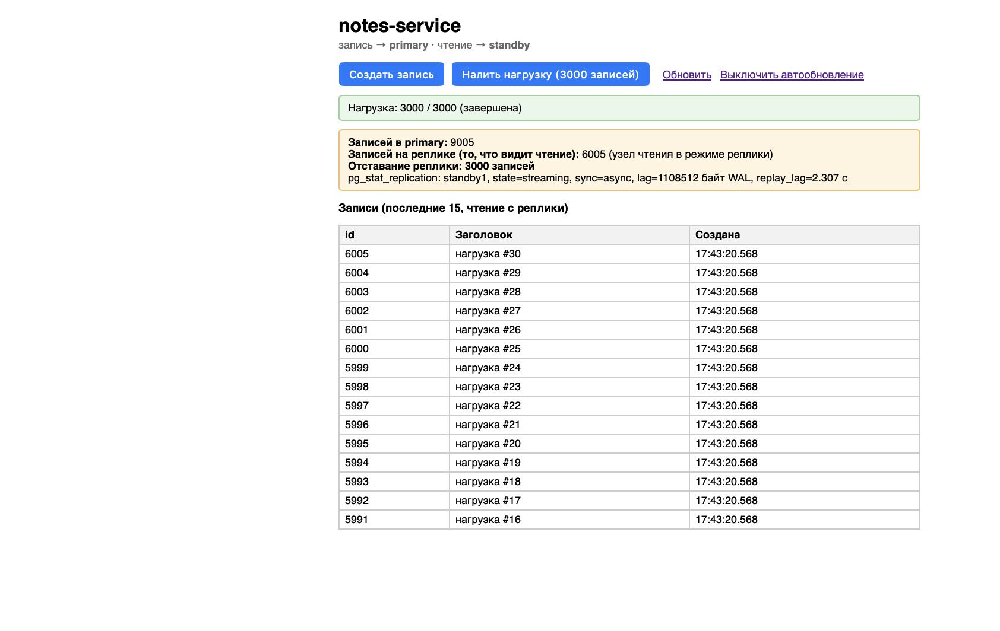

### Как мы измерили отставание

В Postgres есть минимум три способа:

1. **С primary, во вьюхе `pg_stat_replication`** — самый удобный: сколько байт WAL реплика ещё не применила (`pg_wal_lsn_diff(pg_current_wal_lsn(), replay_lsn)`) и сколько это в секундах (`replay_lag`, есть ещё `write_lag` и `flush_lag`). Это мы и показываем на странице и в экспортере.
2. **С реплики** — `pg_last_xact_replay_timestamp()` (время последней применённой транзакции) и сравнение `pg_last_wal_receive_lsn()` с `pg_last_wal_replay_lsn()`: сколько WAL получено, но ещё не применено. Полезно, когда нет доступа к primary. Экспортер считает по этому `pg_replication_lag_seconds`.
3. **Просто сравнить `count(*)`** на primary и реплике — грубо, зато нагляднее всего, как раз это и показывает наша страница.

В терминале лаг в байтах и секундах можно смотреть так (в момент нагрузки):

```bash
while true; do docker compose exec -T primary psql -U postgres -d notes -At -F ' | ' -c "SELECT now()::time(0) AS время, application_name, pg_wal_lsn_diff(pg_current_wal_lsn(), replay_lsn) AS lag_bytes, replay_lag FROM pg_stat_replication"; sleep 1; done
```

На нагрузке 3000 записей очередь на реплику доходила до **≈1 МБ WAL**, а `replay_lag` — до **≈5 секунд** (ровно наша задержка):

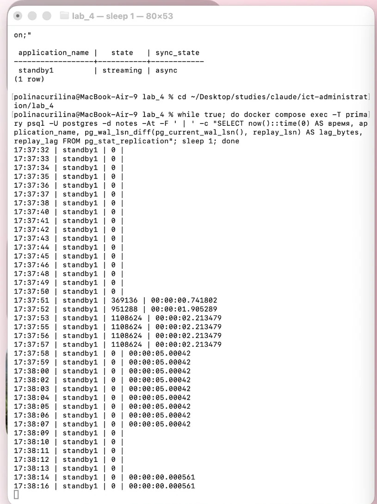

### Почему так происходит

Репликация у нас **асинхронная**: primary записал изменение в свой WAL, ответил клиенту «коммит выполнен» и сразу пошёл дальше. А WAL при этом отправляется реплике и применяется на ней **отдельно, позже**. Primary не ждёт реплику — поэтому быстро, но между «записали» и «увидели на реплике» всегда есть окно.

### Чем это грозит

- **Чтение устаревших данных.** Пользователь создал заметку и сразу открыл список — читающий запрос ушёл на реплику, а заметки там ещё нет. Для него «сохранилось, но пропало». Нарушена гарантия *read-your-writes*.
- **Расхождение в отчётах и логике.** Два соседних запроса (один на primary, другой на реплике) видят разное состояние. Логика вида «записали → проверили чтением → если не нашли, создаём заново» создаст дубли.
- **Потеря данных при отказе primary.** Всё, что primary уже подтвердил клиентам, но ещё не успел отдать реплике, при падении primary и повышении реплики **пропадёт** — реплика этих транзакций просто никогда не видела. Чем больше лаг, тем больше потенциальная потеря (это и есть RPO).
- **Рост WAL на primary.** Пока реплика отстаёт (особенно со слотом репликации), primary обязан хранить непереданный WAL на диске — при долго упавшей реплике диск primary может переполниться.

### Мониторинг лага

На дашборде (часть 6) лаг виден отдельной панелью, а алерт `PostgresReplicationLagHigh` срабатывает после нагрузки:

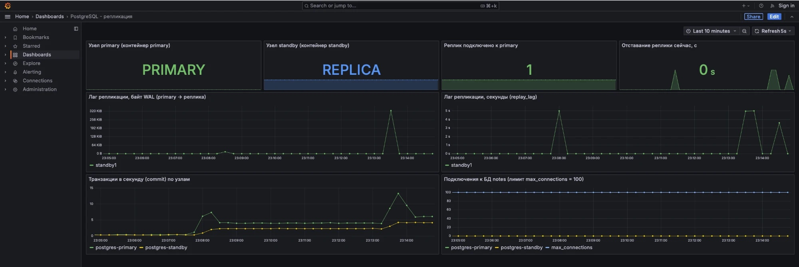

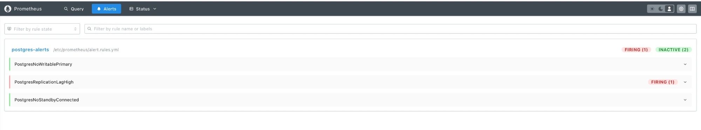

---

## Часть 4 — Теорема CAP

**К чему тяготеет наша настройка сейчас — к A (доступности).**

Напомним теорему: при разрыве связи между узлами нельзя одновременно оставить систему и **согласованной** (все узлы отдают одинаково свежие данные), и **доступной** (каждый запрос получает ответ). Разрыв сети (P) неизбежен, поэтому выбор всегда между C и A.

Наша асинхронная репликация — уклон в сторону **A**:
- записи принимаются в primary всегда, даже если реплика недоступна — **запись не блокируется ничем**;
- чтение с реплики отвечает всегда, даже если реплика отстаёт, — **но может отдать устаревшие данные** (то, что мы наблюдали в части 3). Система выбрала «ответить быстро, пусть чуть неточно», а не «лучше ошибка, чем неверные данные».

### Как сместиться в сторону C

Нужно сделать репликацию **синхронной** — чтобы primary не подтверждал коммит, пока реплика не подтвердит, что получила (и применила) изменения. В Postgres это две настройки на primary (в `docker-compose.yml`):

```yaml
- synchronous_commit=remote_apply    # было on
- synchronous_standby_names=standby1 # было пусто
```

`standby1` — это `application_name` реплики из её `primary_conninfo`.

У `synchronous_commit` есть ступени, и между ними разные гарантии. Мы замерили время создания одной записи через сервис, при включённой на реплике задержке применения в 5 секунд:

| режим | время записи | что гарантирует | что видно на реплике сразу после записи |
|---|---|---|---|
| асинхронно (как было) | ≈ 0.01 с | ничего: реплика может ещё вообще не получить | записи нет (лаг) |
| синхронно, `synchronous_commit=on` | ≈ 0.017 с | реплика **записала** WAL на диск (запись не потеряется) | записи **всё ещё может не быть** — на диске есть, но не применена |
| синхронно, `synchronous_commit=remote_apply` | **≈ 5.0 с** | реплика **применила** WAL | запись уже видна — читающий запрос на реплике увидит свои же записи |

(Режим `on` мы замеряли отдельно, без скриншота; скриншот ниже — про асинхронный режим и `remote_apply`.)

То есть `on` защищает от **потери** данных, а чтобы реально убрать **устаревшие чтения** (настоящий C), нужен `remote_apply`.

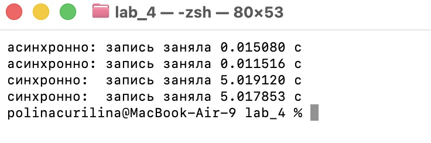

### Чем платим за C

1. **Задержкой каждой записи.** Теперь каждый коммит ждёт реплику. У нас это ≈5 с (потому что реплика специально тормозит), в реальности — сетевой round-trip плюс время применения на реплике, но принцип тот же: запись стала медленнее, а при нагрузке — сильно медленнее.
2. **Доступностью записи.** Самый больной пункт. Мы остановили реплику (`docker compose stop standby`) при включённой синхронной репликации — и **запись перестала проходить совсем**: запрос «Создать запись» висит. В `pg_stat_activity` висящий коммит стоит в ожидании `SyncRep`:

```bash
docker compose stop standby
curl -s -o /dev/null -w "запись заняла %{time_total} c\n" --max-time 10 -X POST http://localhost:8020/create
docker compose exec primary psql -U postgres -d notes -c "SELECT pid, state, wait_event_type, wait_event, left(query, 30) AS query FROM pg_stat_activity WHERE wait_event = 'SyncRep';"
```

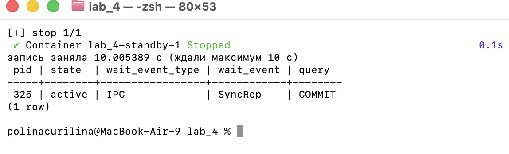

То есть мы сознательно выбрали **C ценой A**: лучше не принять запись вообще, чем принять и потерять/разойтись. В проде это смягчают, указывая несколько реплик и «достаточно подтверждения от любой одной» (`synchronous_standby_names = 'ANY 1 (standby1, standby2)'`), чтобы падение одной реплики не останавливало запись. Читать с реплики при этом по-прежнему можно (A для чтения сохраняется).

После этого эксперимента мы вернули конфигурацию к асинхронной (`on` и пустой `synchronous_standby_names`) — для следующей части нужна именно она.

---

## Часть 5 — Failover: роняем primary

### Что делали

Репликация асинхронная, failover ручной. Шаги:

**1. «Роняем» primary.**

```bash
docker compose stop primary
```

**2. Пробуем писать.** Нажимаем «Создать запись» — запись не проходит:

```
Запись НЕ прошла: could not translate host name "primary" to address: Name or service not known
```

(Контейнер остановлен, Docker уже не резолвит его имя; на настоящем сервере тут была бы `connection refused` или таймаут — суть та же.) А вот **чтение продолжает работать**: список «Записи» и счётчик на реплике показываются как обычно, потому что читаем с реплики, и она жива. Заметка: сервис не упал целиком — деградировал только запись.

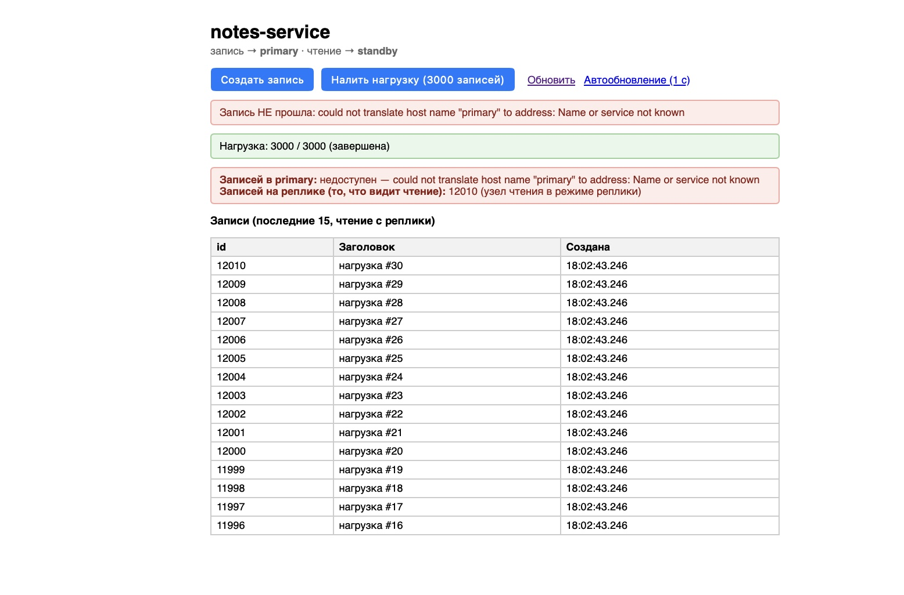

**3. Повышаем реплику до primary** (промоушен):

```bash
docker compose exec standby psql -U postgres -d notes -c "SELECT pg_promote();"
docker compose exec standby psql -U postgres -d notes -c "SELECT pg_is_in_recovery();"
```

`pg_promote()` вернул `t`, а `pg_is_in_recovery()` стал `f` — узел перестал быть репликой. В логе Postgres: `received promote request` → `selected new timeline ID: 2` → `database system is ready to accept connections`. Заметим про **timeline 2**: у Postgres каждая «ветка истории» (до и после повышения реплики) имеет свой номер — это важно в пункте про вернувшийся primary ниже.


**4. Переключаем сервис на новый primary — через конфиг**, как и всё в этой лабе. В `docker-compose.yml` у сервиса `app`:

```yaml
PRIMARY_HOST: standby   # было primary
REPLICA_HOST: standby
```

и `docker compose up -d app`. Теперь запись снова проходит. Страница честно говорит, что узел, с которого мы читаем, **сам является primary**, и что реплик у него нет:

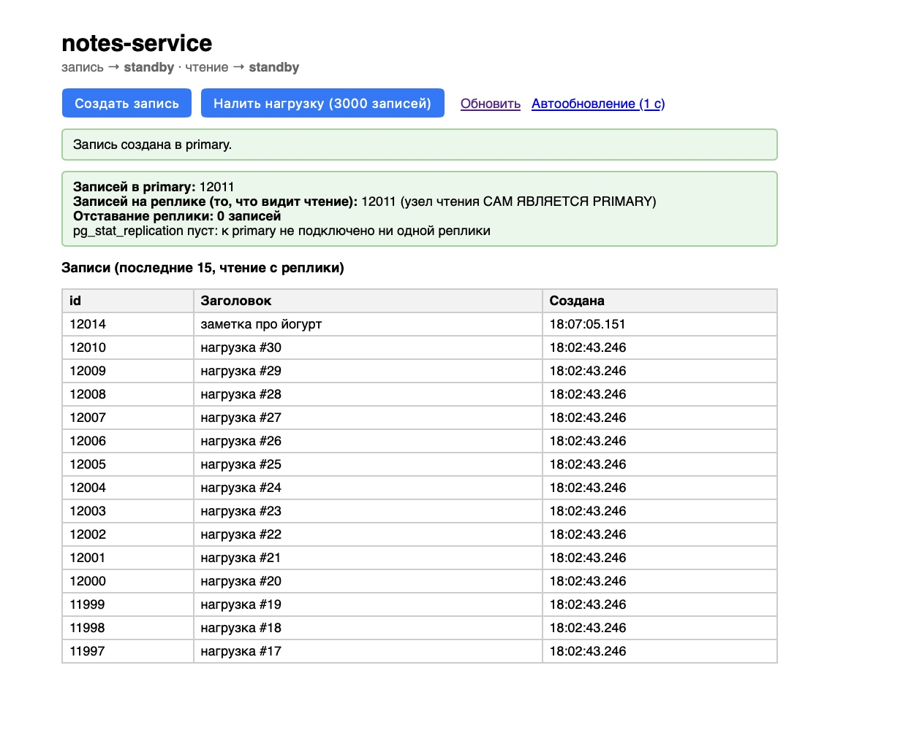

**Данные при этом не потерялись.** В нашем прогоне нагрузка к моменту остановки primary успела закончиться (на скриншоте выше «Нагрузка: 3000 / 3000 (завершена)»), на реплике было **12010 записей**, и ровно столько же оказалось потом у старого primary (см. ниже: 12010) — промоушен ничего не потерял, а следующая запись уже у нового primary стала 12011-й. Когда мы в пробных прогонах останавливали primary прямо **посреди** нагрузки, сервис показывал ошибку «connection already closed», а число записей на реплике после промоушена было не меньше числа подтверждённых сервисом пачек. Потеряться могли бы только транзакции, которые primary подтвердил, но не успел отправить на реплику: на локальной машине WAL едет быстро и всё успевает, но у асинхронной репликации на этот счёт **нет гарантий**, и в проде при лаге в секунды это реальные потерянные записи (см. часть 3).

### Что было бы, если бы старый primary вернулся

Мы проверили на деле — запустили старый primary обратно (`docker compose start primary`):

```bash
docker compose start primary
docker compose exec primary psql -U postgres -d notes -Atc "SELECT 'старый primary: in_recovery=' || pg_is_in_recovery() || ', записей=' || count(*) FROM notes;"
docker compose exec standby psql -U postgres -d notes -Atc "SELECT 'новый primary:  in_recovery=' || pg_is_in_recovery() || ', записей=' || count(*) FROM notes;"
docker compose exec primary psql -U postgres -Atc "SELECT 'старый primary, timeline=' || timeline_id FROM pg_control_checkpoint();"
docker compose exec standby psql -U postgres -Atc "SELECT 'новый primary,  timeline=' || timeline_id FROM pg_control_checkpoint();"
```

Результат: **оба узла считают себя primary** (`in_recovery=false`), у них разные timeline (1 и 2) и разное число записей. Старый primary ничего не знает про то, что реплику повысили: он поднял свои данные с диска и спокойно принимает записи — прямо в него можно вставить строку:

```bash
docker compose exec primary psql -U postgres -d notes -c "INSERT INTO notes(title, body) VALUES ('split-brain', 'пишу в старый primary') RETURNING id;"
``` Это классический **split-brain** («расщеплённый мозг»): две «главные» базы, у каждой своя правда, и данные уже разошлись. Если бы сервис вдруг пошёл писать и туда и сюда — слить обратно это без ручной разборки нельзя.

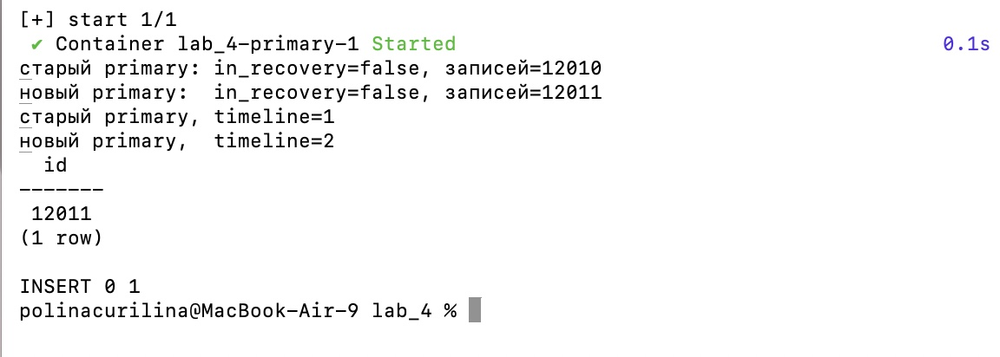

Поэтому после failover старый primary нужно **изолировать** (не давать ему подниматься и принимать записи — это называется *fencing*, в тяжёлом варианте STONITH — «shoot the other node in the head»), а потом вернуть в строй уже **репликой** нового primary: переналить из него данные (`pg_basebackup` заново) или откатить расхождение через `pg_rewind`.

### Как в проде автоматизируют ручной failover

Сами руками «повысить и переключить» в 3 часа ночи никто не хочет, и делают это не люди, а специальный инструмент, который сам проверяет жив ли primary, выбирает реплику, повышает её, изолирует старый primary и переключает клиентов:
- **Patroni** (самый распространённый; хранит «кто главный» в кластере etcd/Consul/ZooKeeper — так узлы договариваются и split-brain невозможен);
- **repmgr**, **pg_auto_failover**, **Stolon**;
- в облаке — управляемые сервисы (RDS, Cloud SQL и т.п.), где failover уже встроен;
- клиентов к нужному узлу направляют **HAProxy/PgBouncer** или виртуальный IP, чтобы сервису не надо было править конфиг и перезапускаться, как это пришлось делать нам.

---

## Часть 6 — Мониторинг

### Что используем

Postgres сам отдаёт метрики не в формате Prometheus, поэтому на каждый узел — свой **`postgres_exporter`** (на `primary` и на `standby`). Дальше как в предыдущих лабах: Prometheus → Grafana, алерты → Alertmanager → webhook.

Стандартного коллектора для `pg_stat_replication` в этой версии экспортера нет, поэтому мы добавили свой файл запросов `postgres-exporter/queries.yaml` с двумя метриками: лаг (в байтах и секундах) по каждой реплике и число подключённых реплик.

Название `job` в Prometheus — это **«какой узел»** (`postgres-primary`, `postgres-standby`), а не «какая роль»: после failover роль узла меняется, а имя контейнера нет. Роль узла экспортер сам отдаёт метрикой `pg_replication_is_replica` (0 — primary, 1 — реплика).

### Дашборд

Собран в Grafana (`grafana/provisioning/dashboards/postgres-dashboard.json`, подхватывается при старте). Панели:

| Панель | Запрос (PromQL) | Зачем |
|---|---|---|
| Узел primary / Узел standby | `sum(pg_replication_is_replica{job="postgres-primary"}) or vector(-1)` | **роль** каждого узла: PRIMARY / REPLICA / НЕДОСТУПЕН — меняется прямо на глазах при failover |
| Реплик подключено к primary | `sum(pg_replication_standbys_connected) or vector(0)` | есть ли у primary хоть одна копия |
| Отставание реплики сейчас, с | `max(pg_replication_standby_replay_lag_seconds) or vector(0)` | насколько реплика «в прошлом» |
| Лаг репликации, байт WAL | `pg_replication_standby_lag_bytes` | сколько WAL реплика ещё не применила |
| Лаг репликации, секунды | `pg_replication_standby_replay_lag_seconds` | то же в секундах |
| Транзакции в секунду | `sum by (job) (rate(pg_stat_database_xact_commit{datname="notes"}[30s]))` | нагрузка на каждый узел; видно, куда идёт запись |
| Подключения к БД | `pg_stat_database_numbackends{datname="notes"}` и `max_connections` | близко ли к лимиту (у нас сервис открывает соединения на лету, поэтому почти всегда около нуля) |

Из лекции в «что мониторят у БД» мы взяли **число подключений**, **отставание реплик** и **нагрузку (TPS)**; медленные запросы, cache hit ratio и рост WAL оставили за рамками этой лабы.

В спокойном состоянии:

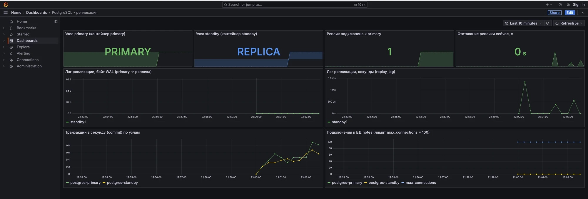

После failover роли на дашборде меняются: бывший primary — «НЕДОСТУПЕН», повышенная реплика — «PRIMARY», реплик подключено — 0:

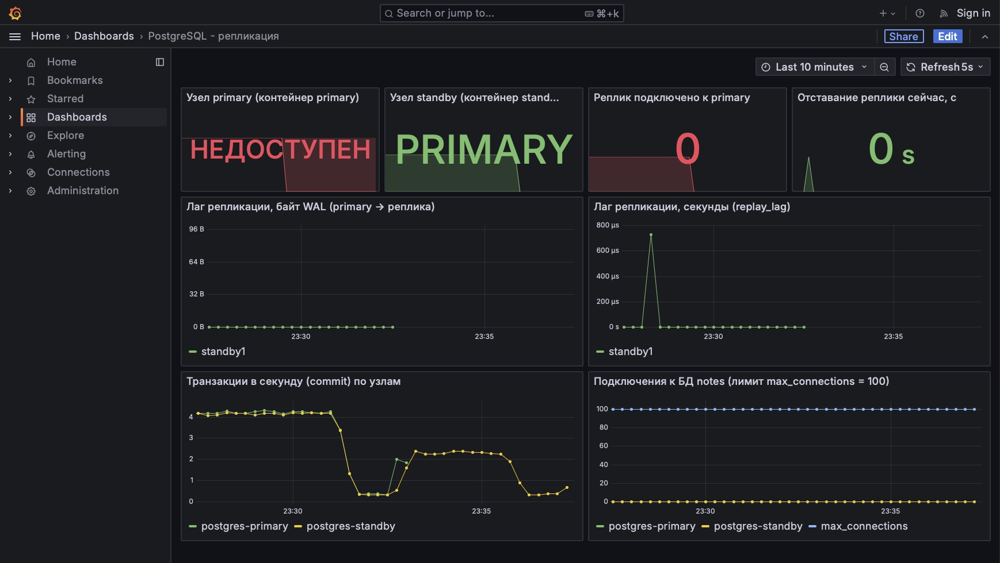

### Три алерта (`prometheus/alert.rules.yml`)

**1. `PostgresNoWritablePrimary` (critical)** — нет ни одного живого узла в роли primary: `pg_up == 1` **и** `pg_replication_is_replica == 0` ни у кого, дольше 10 секунд.
*Что ловит:* падение primary (и любую другую ситуацию, когда писать некуда). *Чем грозит:* полная остановка записи — сервис не может создавать записи, бизнес-операции падают. Условие намеренно сформулировано через **роль**, а не «контейнер primary жив»: алерт сам гаснет, как только реплика повышена и стала primary — то есть показывает «записать некуда», а не «умер конкретный контейнер». Это же правило решает вопрос из лекции «упал ли главный узел».

**2. `PostgresReplicationLagHigh` (warning)** — задержка применения WAL на реплике больше 2 секунд, дольше 5 секунд (`replay_lag` с точки зрения primary).
*Что ловит:* отставание реплики (часть 3): перегруз реплики, медленная сеть, массовая запись. *Чем грозит:* устаревшие чтения (пользователь не видит свои записи), а при падении primary в этот момент — потеря последних транзакций. Порог 2 с взят для нашей лабы с запасом над «нормой» (в спокойном состоянии у нас доли миллисекунд); в реальном проекте его выбирают от бизнеса: сколько устаревания терпимо. Добавили `keep_firing_for: 30s` — алерт ещё 30 секунд держится после того, как лаг ушёл (защита от «мигания» на коротких всплесках и время, чтобы успеть его заметить).

**3. `PostgresNoStandbyConnected` (critical)** — у узла, который работает как primary, нет ни одной подключённой реплики (`pg_replication_standbys_connected == 0` при `pg_replication_is_replica == 0`), дольше 10 секунд.
*Что ловит:* реплика отвалилась (упала, потеряла сеть, не стартовала) — **и ситуацию сразу после failover**, когда новый primary остался один. *Чем грозит:* копии данных нет: следующий отказ primary — это уже потеря данных, а не просто перебой; читать масштабировать тоже не на что. При этом алерт не срабатывает на самой реплике (у реплики 0 «подключённых реплик» — это нормально, поэтому условие проверяет ещё и роль узла).

Почему именно эти три: они закрывают три разных «этажа» репликации — **есть ли куда писать** (primary), **есть ли копия** (реплика подключена), **насколько копия свежая** (лаг). Остальное (число подключений, нагрузка) мы оставили на дашборде как фон, но не как повод будить ночью.

В спокойном состоянии все три правила `inactive`:

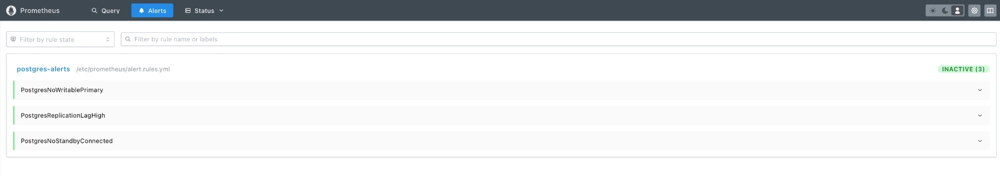

После остановки primary (через ≈15 секунд — 10 секунд `for` плюс интервал опроса) загорается `PostgresNoWritablePrimary`:

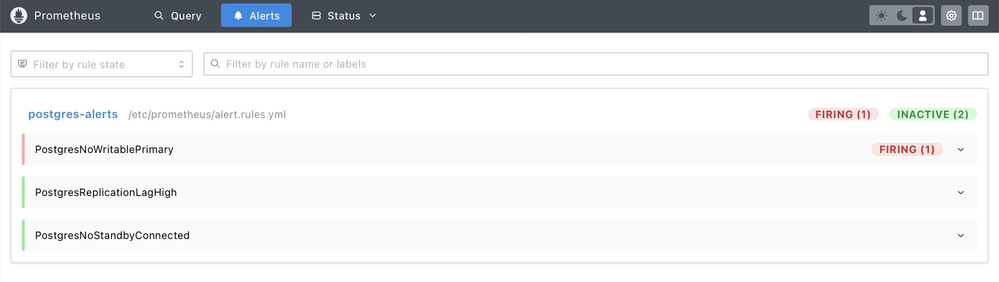

После повышения реплики этот алерт гаснет, а вместо него загорается `PostgresNoStandbyConnected` — новому primary не с кем делиться данными.

Кстати, когда в части 5 вернулся старый primary, на дашборде **оба узла показали PRIMARY** — это и есть split-brain глазами мониторинга. Отдельный алерт на него мы заводить не стали (в проде это обязанность fencing/Patroni, мониторинг тут вторичен), но он делается одной строкой: `count((pg_up == 1) and on(instance) (pg_replication_is_replica == 0)) > 1`. Alertmanager доставляет уведомления на webhook:

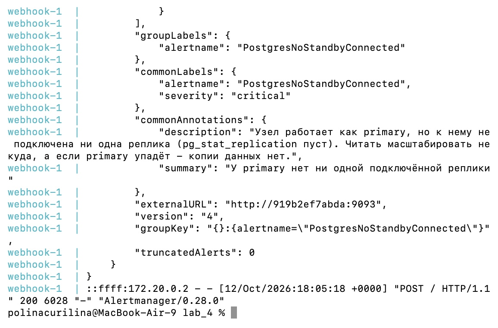

---

## Грабли

- **Лага «в чистом виде» локально не видно.** Два контейнера на одном компьютере синхронизируются за миллисекунды. Нам пришлось включить `recovery_min_apply_delay`, чтобы он стал заметен. Вывод: «я не вижу лага у себя на ноутбуке» ≠ «лага нет в проде».
- **Сервис видел `NULL` вместо лага.** Пользователь `app` по принципу наименьших привилегий может читать `pg_stat_replication`, но Postgres прячет от него все поля с подробностями (LSN, задержки). Помогла выдача роли `pg_read_all_stats` — она даёт читать статистику, но не данные таблиц.
- **`pg_hba.conf` и replication-соединения.** Стандартные правила `host all all ...` на репликацию не распространяются: у replication-соединений своё «виртуальное» имя базы `replication`, и разрешать его надо отдельной строкой (мы добавили её сразу в init-скрипт). Это одна из самых частых причин «реплика не подключается».
- **`\watch` внутри `psql -c` не работает.** Хотели смотреть лаг командой `psql -c "SELECT ... \watch 1"` — получили syntax error (команды с `\` надо отдавать отдельно). Проще оказался цикл `while true; do ...; sleep 1; done` в shell.
- **`PRIMARY_HOST` в двух местах.** Эта переменная была и у сервиса, и у реплики (откуда делать basebackup); при переключении сервиса на новый primary легко поменять не ту. Переименовали переменную реплики в `UPSTREAM_HOST`.
- **`or vector(0)` и метки в PromQL.** Тот же урок, что в лабе 3: `or vector(0)` склеивается по набору меток, поэтому перед ним нужен `sum(...)`/`count(...)`, иначе серии не схлопываются. На панели «Узел primary» поэтому `sum(...) or vector(-1)`: при пропаже метрики показывается «НЕДОСТУПЕН», а не пустое место.

---

## Выводы

- **Репликация — это не копия «по запросу», а непрерывный поток WAL.** Реплика получает журнал и применяет его своим темпом; «отстаёт» она не потому что что-то сломалось, а потому что так устроена асинхронность. Всё, что мы увидели в части 3 — штатное поведение.
- **Асинхронность = скорость + устаревшие данные + возможная потеря при отказе.** Синхронность убирает эти риски, но заставляет платить задержкой каждой записи и доступностью (запись может встать совсем). Это и есть CAP на живом примере: C или A, бесплатного «и то, и то» нет. У `synchronous_commit` ещё и несколько ступеней (`on` защищает от потери, `remote_apply` — от устаревших чтений), и между ними мы заметили разницу в сотни раз по времени записи.
- **Failover — это не только «повысить реплику».** Нужно ещё переключить клиентов, не допустить возвращения старого primary в роли primary (split-brain мы воспроизвели руками) и вернуть его в строй репликой. Поэтому в проде это отдают Patroni и подобным инструментам, а не человеку.
- **Мониторинг должен смотреть на роли, а не на имена контейнеров.** После failover «primary» — это уже другой контейнер, и алерт вида «контейнер primary упал» бессмысленен; а «ни один узел не отвечает в роли primary» — осмысленен всегда.

Чего не хватает для «взрослой» версии:
- автоматический failover (Patroni + etcd) вместо ручного `pg_promote()`;
- несколько реплик и кворумная синхронная репликация (`ANY 1 (...)`), чтобы падение одной не останавливало запись;
- PgBouncer и единая точка входа (HAProxy/VIP), чтобы сервис не знал, кто сейчас primary;
- бэкапы и **проверенное** восстановление (`pg_dump`, физические бэкапы + PITR) — они были в лекции, но не в этой лабе;
- миграции схемы (Alembic/Flyway) вместо `CREATE TABLE` в init-скрипте;
- пароли не в `docker-compose.yml`, а в секретах.

---

## Про инструменты

Писали на Python + Flask (драйвер `psycopg2`). Инфраструктура: Docker Compose, PostgreSQL 16 (streaming replication), postgres_exporter, Prometheus, Alertmanager, Grafana. Пользовались AI-ассистентом — для генерации кода сервиса и конфигов, отладки перечисленных выше граблей и прогона всех сценариев (лаг, синхронная репликация, failover, split-brain) перед тем, как повторить их руками для скриншотов.
