# Лаба 5 — Развернуть ELK и потрогать Эластик руками

**Авторы:** Чурилина Полина Олеговна, Арбузина Елена Романовна
**Группа:** К3320
**Репозиторий:** https://github.com/churilina-polina/ict-administration → папка `lab_5/`

---

## О чём лаба

Поднимаем локально **Elasticsearch + Kibana** (одноузловой кластер), заливаем в него **логи приложения** и учимся с ними работать: искать, фильтровать, агрегировать, смотреть в Kibana. По пути разбираемся со статусом кластера, шардами и репликами, настраиваем ротацию логов (**ILM + rollover**) и, как всегда, мониторинг: Prometheus + Grafana + алерты.

Сценарий один — логи: это то, ради чего devops поднимает Эластик чаще всего (поиск по `trace_id`, число ошибок по сервисам за период и т.д.).

---

## Структура репозитория

```
lab_5/
├── docker-compose.yml                ← поднимает весь стенд одной командой
├── logs/
│   └── generate_logs.py              ← генератор тестовых логов (Bulk API, NDJSON)
├── kibana-requests/                  ← готовые запросы для Kibana Dev Tools (копируем и выполняем)
│   ├── 01-cluster-and-index.txt
│   ├── 02-search-and-aggs.txt
│   └── 03-ilm-rollover.txt
├── prometheus/
│   ├── prometheus.yml
│   └── alert.rules.yml
├── alertmanager/alertmanager.yml
├── grafana/provisioning/             ← Grafana настраивает себя сама при старте
│   ├── datasources/datasources.yml
│   └── dashboards/{dashboards.yml, elasticsearch-dashboard.json}
└── images/                           ← скриншоты для этого отчёта
```

### Из чего собран стенд

| Контейнер | Образ | Порт на localhost | За что отвечает |
|---|---|---|---|
| `elasticsearch` | `elasticsearch:8.15.3` | 9201 | сам Elasticsearch, один узел `es01` |
| `kibana` | `kibana:8.15.3` | 5602 | веб-интерфейс: Dev Tools, Discover, визуализации |
| `elasticsearch-exporter` | `elasticsearch-exporter:v1.8.0` | 9114 | отдаёт метрики кластера в формате Prometheus |
| `prometheus` | `prom/prometheus:v3.1.0` | 9097 | собирает метрики, проверяет правила алертов |
| `alertmanager` | `prom/alertmanager:v0.28.0` | 9098 | принимает сработавшие алерты |
| `webhook` | `mendhak/http-https-echo` | 8084 | приёмник уведомлений (для проверки) |
| `grafana` | `grafana/grafana:11.4.0` | 3003 | дашборд |

> Стандартные порты на этом компьютере заняты: 9200 и 5601 — виртуальной машиной Lima (из другого курса), 9090/3000 и соседние — стендами предыдущих лаб. Поэтому у Elasticsearch порт **9201**, у Kibana — **5602**.

Logstash и Beats мы не поднимали: по заданию достаточно Elasticsearch и Kibana, а логи заливаем напрямую через Bulk API. В реальном ELK между сервисами и Elasticsearch стоял бы Filebeat/Logstash (см. «Выводы»).

---

## Как запустить

```bash
cd lab_5
docker compose up -d
docker compose ps
```

Первый раз тянутся образы (Elasticsearch и Kibana — по несколько сотен МБ), это несколько минут. Дальше Elasticsearch стартует за десяток секунд, Kibana — ещё немного позже.

Что важно в `docker-compose.yml` у Elasticsearch:

```yaml
discovery.type: single-node            # один узел: не ищем соседей и не выбираем мастера
xpack.security.enabled: "false"        # только для учебного стенда (в проде нужны TLS и пароли)
ES_JAVA_OPTS: -Xms512m -Xmx512m        # JVM heap: минимум = максимуму, и не больше 50% памяти (из лекции)
indices.lifecycle.poll_interval: 10s   # как часто ILM проверяет условия (по умолчанию 10 минут!)
```

Последняя настройка нужна только для демо: иначе rollover пришлось бы ждать до десяти минут.

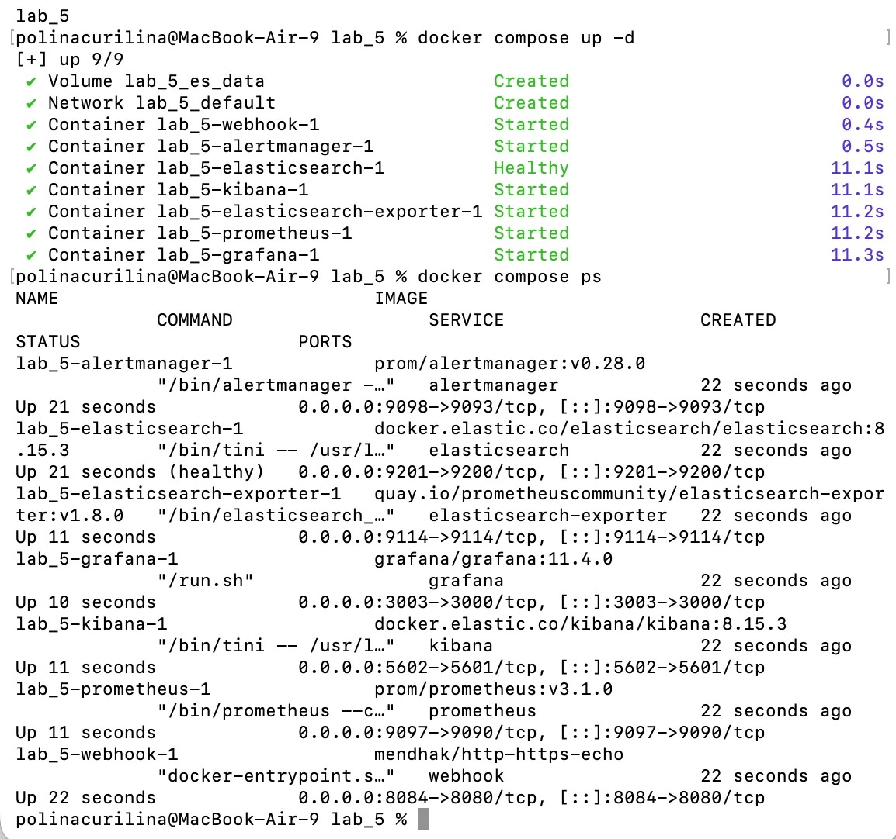

Веб-интерфейсы: Kibana — http://localhost:5602, Grafana — http://localhost:3003, Prometheus — http://localhost:9097, Elasticsearch (сам API) — http://localhost:9201.

Остановить всё вместе с данными: `docker compose down -v`.


Основная работа дальше идёт в **Kibana → Dev Tools → Console** (http://localhost:5602/app/dev_tools#/console): слева запрос, справа ответ. Готовые запросы лежат в `kibana-requests/*.txt`.

---

## Часть 1 — Состояние кластера

Первый запрос — здоровье кластера:

```
GET _cluster/health
```

На свежем кластере результат **green**, один узел (`number_of_nodes: 1`). Единственные индексы на этот момент — служебные индексы самой Kibana, и они сделаны так, что на одном узле обходятся без реплик (у них `auto_expand_replicas: 0-1`), поэтому кластер зелёный.

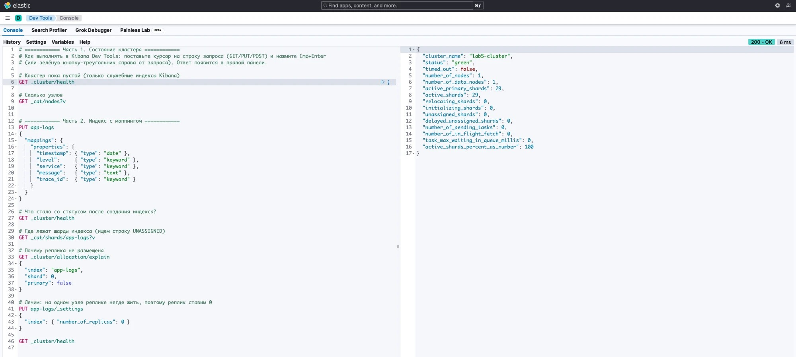

### Какой статус бывает на одном узле и почему

Зелёным кластер остаётся, пока в нём нет ни одного «обычного» индекса. Как только мы создаём свой индекс (см. часть 2), статус становится **yellow**: у нового индекса по умолчанию 1 шард и **1 реплика**, а реплику Elasticsearch **никогда не кладёт на тот же узел, что и её первичный шард** (иначе в ней нет смысла: упал узел — пропали обе копии). Узел у нас один, поэтому первичный шард размещён (`p STARTED`), а реплика — нет (`r UNASSIGNED`).

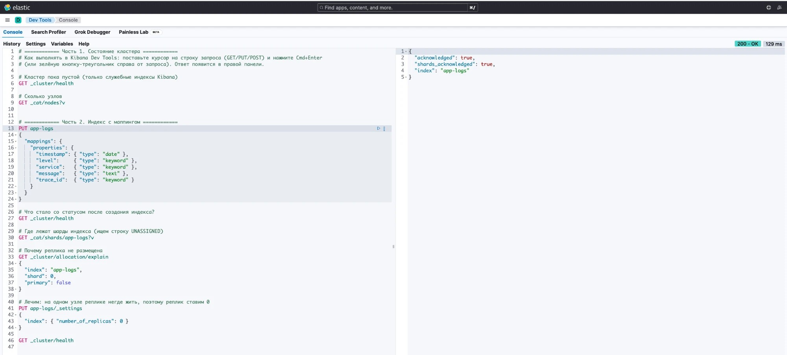

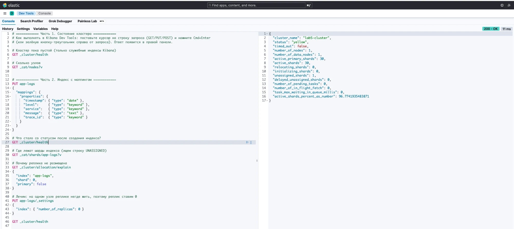

Где лежат шарды — видно в `_cat/shards`:

```
GET _cat/shards/app-logs?v
```

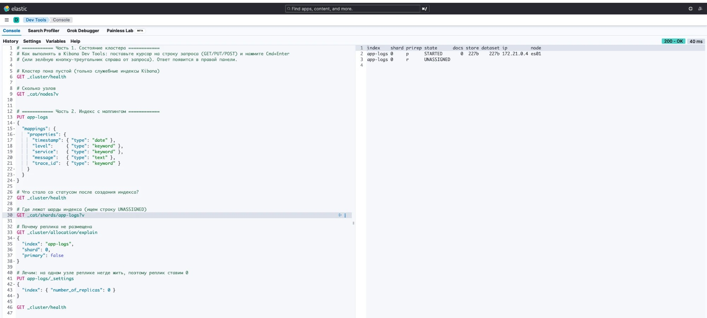

А **почему** — отвечает `allocation/explain`: решатель `same_shard` запрещает класть копию шарда на узел, где уже лежит эта же копия.

```
GET _cluster/allocation/explain
{ "index": "app-logs", "shard": 0, "primary": false }
```

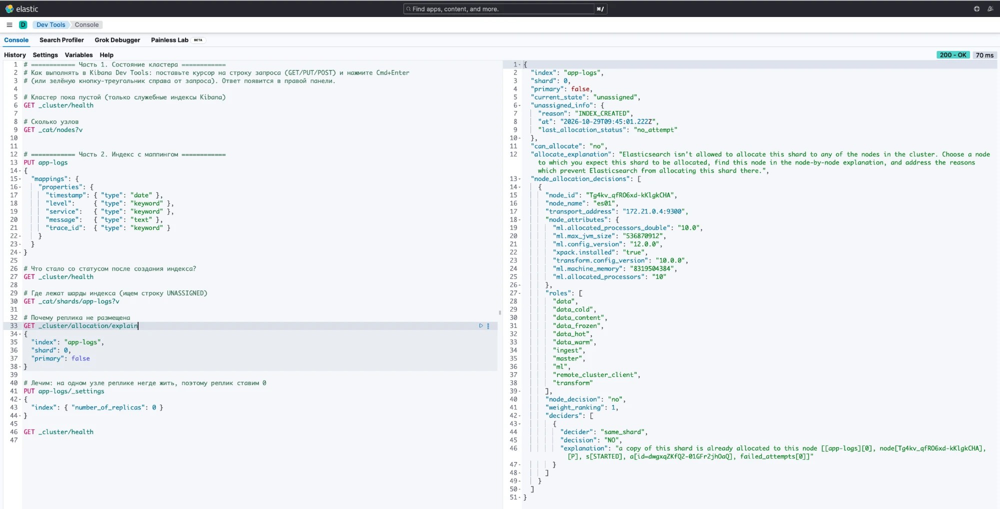

Статусы из лекции: **green** — все шарды (и первичные, и реплики) размещены; **yellow** — первичные размещены, часть реплик нет (данные доступны, но отказоустойчивости нет); **red** — не размещён хотя бы один первичный шард (часть данных недоступна).

### Что нужно, чтобы стало green

Два варианта:
1. **Добавить второй узел** — тогда реплика получит, где разместиться. Это правильный путь для продакшена: реплика нужна как раз для отказоустойчивости.
2. **Убрать реплики** (`number_of_replicas: 0`) — кластер станет зелёным, но отказоустойчивости не будет вообще. На одном узле, где реплике всё равно негде жить, это честный вариант для учебного стенда:

```
PUT app-logs/_settings
{ "index": { "number_of_replicas": 0 } }
```

Пока кластер жёлтый, посмотрим на него глазами мониторинга (подробнее — в части 4): на дашборде статус YELLOW и 1 unassigned shard, а через ≈35 секунд загорается алерт `ElasticsearchClusterYellow`.

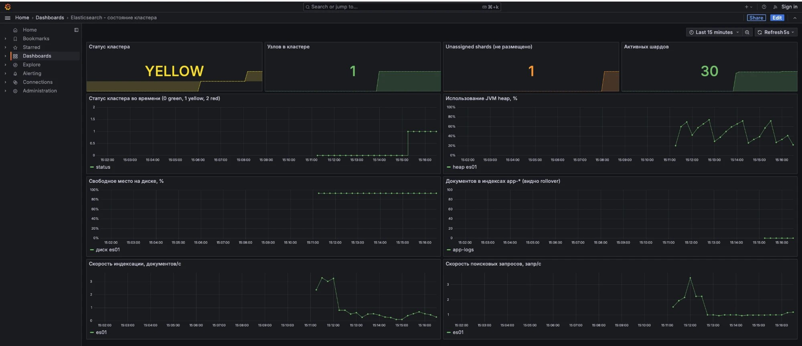

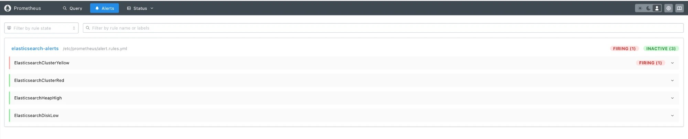

После `PUT app-logs/_settings` с `number_of_replicas: 0` статус возвращается в green:

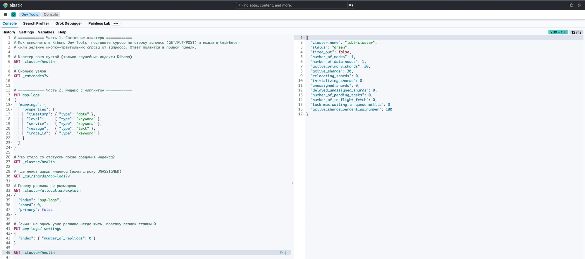

---

## Часть 2 — Данные, индекс и поиск

### Тестовые логи

Настоящего приложения у нас нет, поэтому логи генерируем. Скрипт `logs/generate_logs.py` (написан с помощью AI, на чистом Python без зависимостей) выдаёт **50 записей** в формате Bulk API. Поля: `timestamp` (в пределах последних трёх часов от момента запуска), `level` (INFO/WARN/ERROR), `service` (auth, checkout, catalog, payment, delivery), `message`, `trace_id`.

Два нюанса, ради которых его стоило написать, а не просить AI «нарисовать пару записей»:
- время записей считается **от момента запуска**, поэтому запросы вида «за последний час» (`now-60m`) дают разный результат на разных диапазонах;
- в наборе есть «сломавшийся заказ»: четыре записи с одним `trace_id` в разных сервисах (login → checkout → медленный ответ шлюза → ошибка таймаута). По этому `trace_id` в конце ищем цепочку событий — ровно так разбирают инциденты.

### Индекс с маппингом

Маппинг — это объявление полей и их типов. Тип поля потом нельзя поменять без переиндексации, поэтому задаём явно:

```
PUT app-logs
{
  "mappings": {
    "properties": {
      "timestamp": { "type": "date" },
      "level":     { "type": "keyword" },
      "service":   { "type": "keyword" },
      "message":   { "type": "text" },
      "trace_id":  { "type": "keyword" }
    }
  }
}
```

Главное различие типов: **`text`** анализируется (режется на слова и нормализуется) — по нему ищем полнотекстово; **`keyword`** хранится как есть — по нему точное сравнение, фильтры и агрегации. Поэтому `message` — text, а `level`, `service` и `trace_id` — keyword.

### Заливка логов

```bash
python3 logs/generate_logs.py
curl -s -H "Content-Type: application/x-ndjson" -XPOST "localhost:9201/_bulk?refresh=true" --data-binary @logs/bulk.ndjson | python3 -c "import json,sys; d=json.load(sys.stdin); print('ошибки:', d['errors'], '| записей загружено:', len(d['items']))"
```

`_bulk` принимает файл, где строки чередуются: «действие» (`{"index": {"_index": "app-logs"}}`) и сам документ. `refresh=true` сразу делает записи видимыми для поиска (по умолчанию они становятся видны примерно через секунду — модель near real-time).

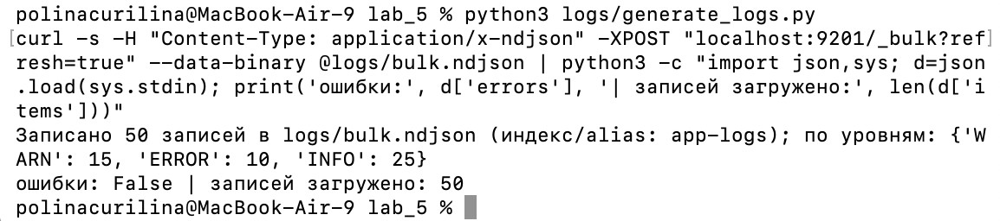

### Запросы

**1. Полнотекстовый поиск по `message`.** `match` режет запрос на термы и ищет их в обратном индексе. Найдено **8** записей со словом `timeout`; порядок задаёт релевантность (`_score`, алгоритм BM25). Обратите внимание: у `Payment timeout while calling bank gateway` оценка **1.72**, а у `Slow response from payment gateway (1800 ms), possible timeout` — **1.41**: слово `timeout` в более коротком сообщении «весит» больше.

```
GET app-logs/_search
{ "query": { "match": { "message": "timeout" } }, "_source": ["timestamp", "level", "service", "message"] }
```

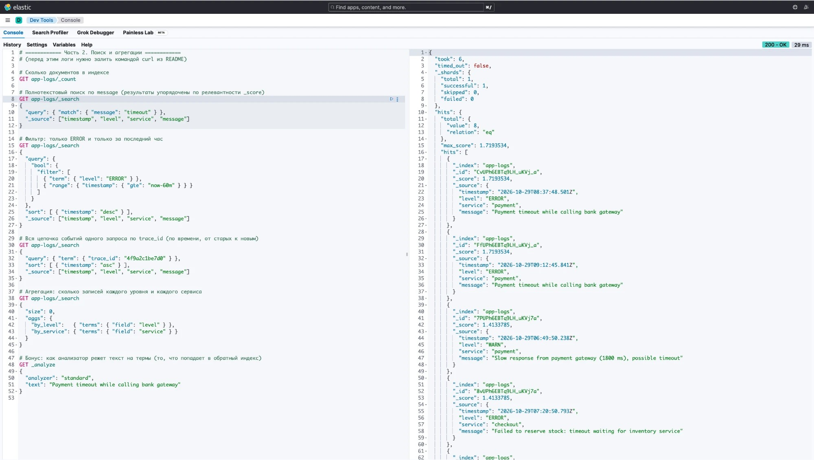

**2. Фильтр по `level = ERROR` и по времени.** `bool.filter` — условия «да/нет» без расчёта релевантности (их Elasticsearch ещё и кеширует), для логов это именно то, что нужно. `now-60m` — запись даты относительно текущего момента. Всего ошибок в индексе 10, а за последний час — в нашем прогоне 5; это число со временем **уменьшается**, потому что записи «стареют» и выпадают из окна.

```
GET app-logs/_search
{
  "query": { "bool": { "filter": [
    { "term":  { "level": "ERROR" } },
    { "range": { "timestamp": { "gte": "now-60m" } } }
  ] } },
  "sort": [ { "timestamp": "desc" } ]
}
```

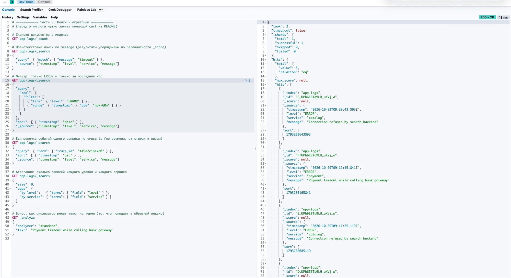

**3. Поиск по `trace_id`.** `term` — точное совпадение по keyword-полю. Находим всю цепочку заказа через четыре события в трёх сервисах: вход пользователя → начало оформления → медленный ответ платёжного шлюза → таймаут.

```
GET app-logs/_search
{ "query": { "term": { "trace_id": "4f9a2c1be7d0" } }, "sort": [ { "timestamp": "asc" } ] }
```

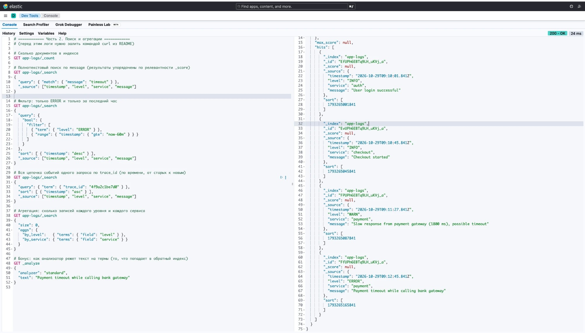

**4. Агрегация.** Сколько записей каждого уровня и каждого сервиса. `size: 0` — сами документы не нужны, только подсчёты:

```
GET app-logs/_search
{ "size": 0, "aggs": { "by_level": { "terms": { "field": "level" } }, "by_service": { "terms": { "field": "service" } } } }
```

Получилось: INFO — 25, WARN — 15, ERROR — 10; по сервисам: checkout — 14, payment — 13, auth — 10, catalog — 10, delivery — 3.

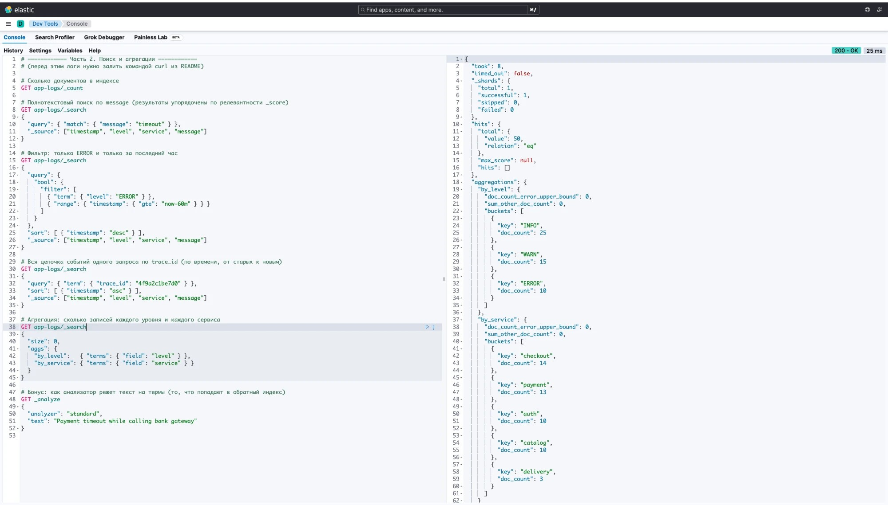

(Бонус в `kibana-requests/02-search-and-aggs.txt`: запрос `GET _analyze` показывает, как анализатор режет текст на термы — то, что попадает в обратный индекс.)

### Kibana: Discover и визуализация

В Kibana логи надо «показать» через **data view** (раньше назывался index pattern): имя `app-logs`, index pattern `app-logs`, поле времени `timestamp`. После создания Kibana показывает список полей и их типы — это тот самый маппинг: `level`, `service`, `trace_id` — keyword, `message` — text, `timestamp` — date.

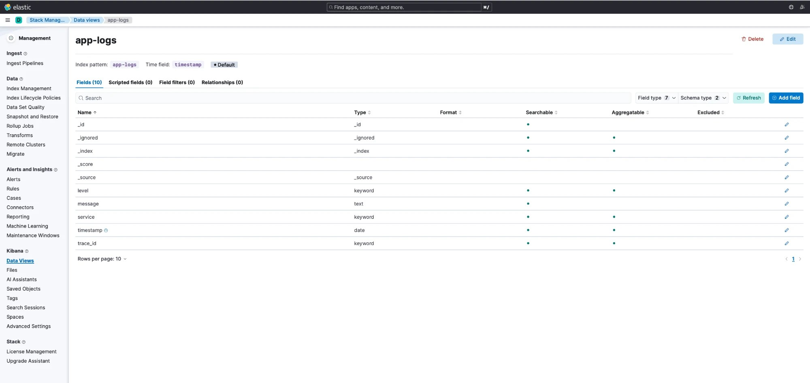

В **Discover** (диапазон времени надо поставить побольше, чем 15 минут по умолчанию, например «Last 24 hours») видна гистограмма записей по времени и сами документы. Фильтр на KQL: `level : "ERROR"`.

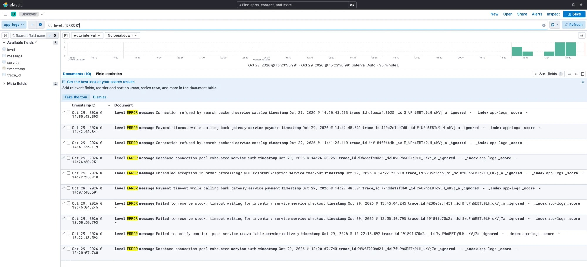

И простая визуализация в **Lens**: столбики по `level` (по оси X — поле `level`, по оси Y — число записей). Получается ровно то, что дала агрегация: INFO 25, WARN 15, ERROR 10.

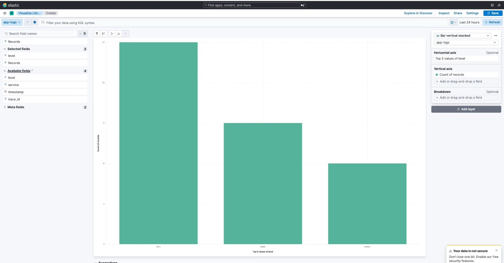

---

## Часть 3 — ILM и rollover

### Зачем

Логи копятся бесконечно. Без ротации диск рано или поздно заполнится, а при flood-stage (95% диска) Elasticsearch переведёт индексы в read-only, и запись прекратится — причём не только логов. ILM (Index Lifecycle Management) автоматически ведёт индекс по стадиям жизни, а **rollover** создаёт новый индекс, когда текущий достиг порога.

### Из чего это собирается

Нужны четыре вещи, и именно в таком порядке:

**1. Политика ILM.** Для демо порог rollover очень маленький — **30 документов** (в реальности — 50 ГБ или сутки; мы тоже оставили `max_age: 1d`, срабатывает то, что наступит раньше). Через **5 минут после rollover** старый индекс удаляется:

```
PUT _ilm/policy/app-rollover-policy
{
  "policy": { "phases": {
    "hot":    { "actions": { "rollover": { "max_docs": 30, "max_age": "1d" } } },
    "delete": { "min_age": "5m", "actions": { "delete": {} } }
  } }
}
```

**2. Шаблон индекса**, который навешивает политику и alias на все новые индексы `app-rollover-*`:

```
PUT _index_template/app-rollover-template
{
  "index_patterns": ["app-rollover-*"],
  "template": {
    "settings": {
      "number_of_shards": 1, "number_of_replicas": 0,
      "index.lifecycle.name": "app-rollover-policy",
      "index.lifecycle.rollover_alias": "app-rollover"
    },
    "mappings": { "properties": { ...тот же маппинг логов... } }
  }
}
```

**3. Первый индекс серии с alias**, в который идёт запись (`is_write_index`). Дальше имена индексов ILM будет придумывать сам (`...-000002`, `...-000003`):

```
PUT app-rollover-000001
{ "aliases": { "app-rollover": { "is_write_index": true } } }
```

**4. Запись в alias, а не в конкретный индекс.** Приложение всегда пишет в `app-rollover`, а за кулисами alias переезжает на новый индекс. Заливаем 40 записей (больше порога в 30):

```bash
python3 logs/generate_logs.py --index app-rollover --count 40 --out logs/bulk-ilm.ndjson
curl -s -H "Content-Type: application/x-ndjson" -XPOST "localhost:9201/_bulk?refresh=true" --data-binary @logs/bulk-ilm.ndjson | python3 -c "import json,sys; d=json.load(sys.stdin); print('ошибки:', d['errors'], '| записано в:', {i['index']['_index'] for i in d['items']})"
```

Все 40 записей уходят в `app-rollover-000001` (видно в выводе: запись шла через alias, а попала в конкретный индекс).

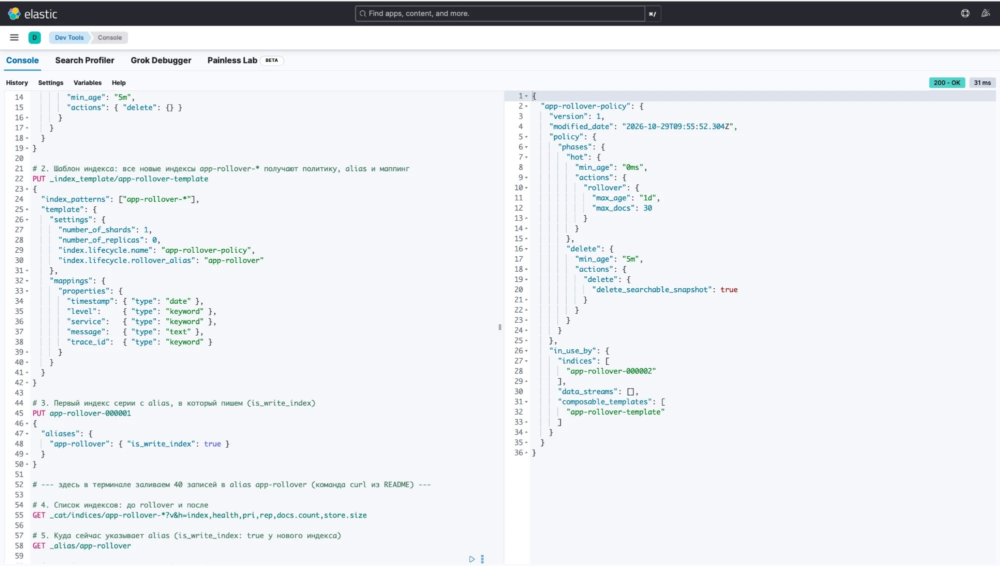

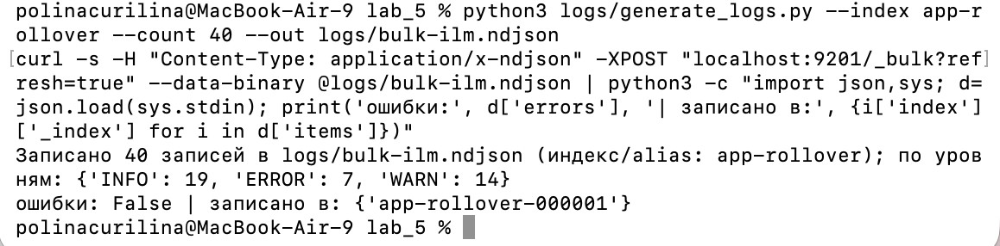

### Rollover случился

ILM проверяет условия не после каждой записи, а раз в `poll_interval` (у нас 10 секунд). Поэтому через 10–20 секунд после записи в `_cat/indices` появляется **следующий индекс**.

Мы прошли этот цикл **дважды**. Первый раз (запись в `app-rollover-000001`) rollover создал `app-rollover-000002`: это видно на дашборде в части 4 (кадр с панелью «Документов в индексах app-*»: у `000001` 40 документов, у `000002` ноль), а потом `000001` был удалён фазой delete. Чтобы заснять сам момент «два индекса одновременно» и переезд alias, мы повторили заливку: те же 40 записей ушли в alias, который теперь смотрел на `app-rollover-000002`:

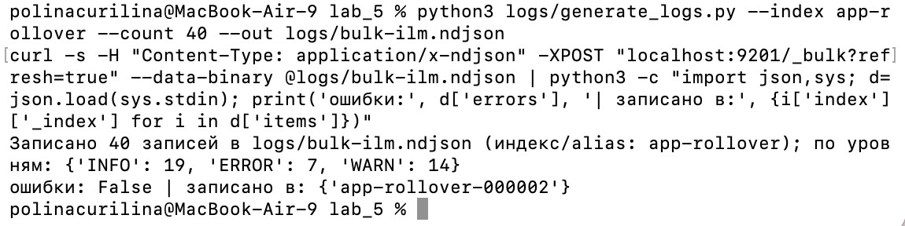

```
GET _cat/indices/app-rollover-*?v&h=index,health,pri,rep,docs.count,store.size
```

В `app-rollover-000002` оказались все **40 документов**, больше порога в 30 (rollover не «режет» индекс и не срабатывает по каждой записи, он просто открывает новый индекс при ближайшей проверке), а новый `app-rollover-000003` пуст и принимает новые записи. `GET _alias/app-rollover` показывает, что флаг `is_write_index: true` переехал на новый индекс, а у старого стал `false`. Приложение, которое пишет в alias, этого даже не заметило.

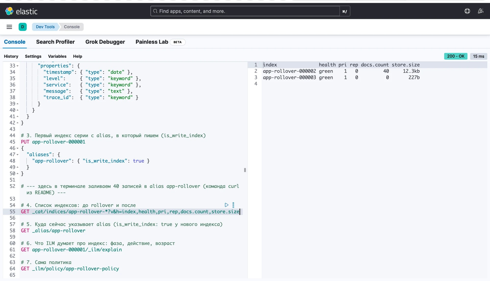

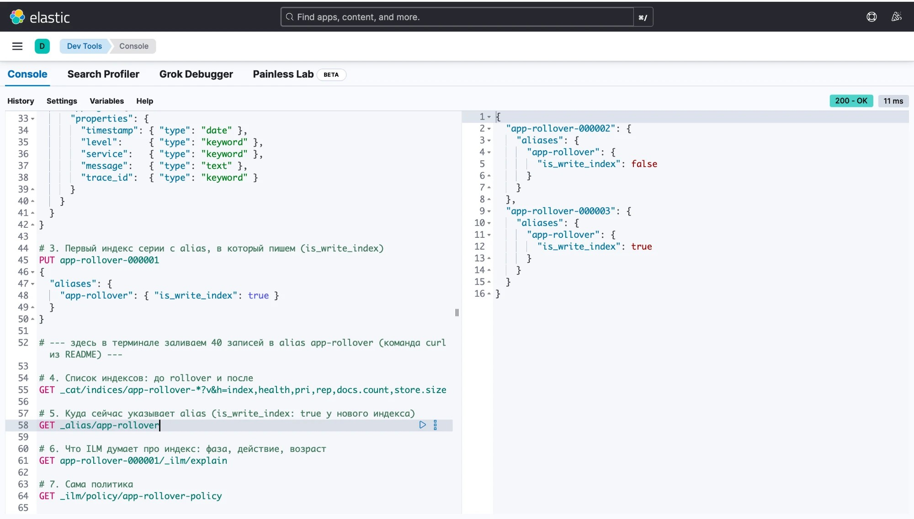

### Фаза delete

Через 5 минут после rollover ILM удаляет старый индекс. После первого цикла в `_cat/indices` остался только `app-rollover-000002` (`000001` удалён); так же через 5 минут после второго rollover исчез бы и `000002`. Это и есть автоматическая ротация: диск не растёт бесконечно, а мы не сделали для этого ни одной ручной команды.

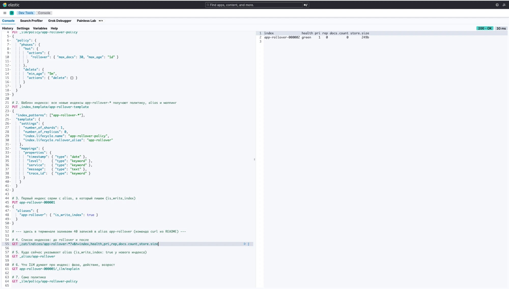

### Грабли

- **Встроенный шаблон `logs-*-*` перехватил имя индекса.** Сначала мы назвали серию `logs-app-000001` — по-человечески, «логи приложения». Ответ: `cannot create index with name [logs-app-000001], because it matches with template [logs] that creates data streams only`. В Elasticsearch 8 есть встроенные шаблоны на имена `logs-*-*`, `metrics-*-*` и им подобные, и они создают только data streams. Решение — назвать серию иначе (`app-rollover-*`). Современная замена связки «alias + rollover» — как раз data streams, но в задании речь про alias.
- **Запись в несуществующий alias молча создала обычный индекс.** Пока первый индекс серии не был создан (упал из-за предыдущей ошибки), мы уже залили логи «в alias» `logs-app` — и Elasticsearch не ругнулся, а **автоматически создал индекс с таким именем** с динамическим маппингом. Вывод: сначала индекс с alias, потом запись, и всегда проверять в ответе, в какой индекс реально попали документы.
- **ILM по умолчанию проверяет условия раз в 10 минут.** Без `indices.lifecycle.poll_interval: 10s` rollover мы бы ждали долго и решили бы, что политика не работает.

---

## Часть 4 — Мониторинг

### Что используем

Elasticsearch сам по себе метрики в формате Prometheus не отдаёт, поэтому рядом — **`elasticsearch-exporter`**: он ходит в API Elasticsearch и отдаёт метрики на `:9114`. Дальше как в предыдущих лабах: Prometheus → Grafana, алерты → Alertmanager → webhook.

### Дашборд

Собран в Grafana (`grafana/provisioning/dashboards/elasticsearch-dashboard.json`, подхватывается при старте):

| Панель | Запрос (PromQL) | Зачем |
|---|---|---|
| Статус кластера | `(sum(...status{color="yellow"}) + 2 * sum(...status{color="red"})) or vector(-1)` | GREEN / YELLOW / RED одним словом; «НЕТ ДАННЫХ», если метрик нет |
| Узлов в кластере | `sum(elasticsearch_cluster_health_number_of_nodes)` | не потеряли ли узел |
| Unassigned shards | `sum(elasticsearch_cluster_health_unassigned_shards)` | причина yellow/red в одной цифре |
| Активных шардов | `sum(elasticsearch_cluster_health_active_shards)` | общая картина по шардам |
| Статус во времени | то же выражение, график | когда именно кластер стал жёлтым |
| Использование JVM heap, % | `100 * jvm_memory_used_bytes{area="heap"} / jvm_memory_max_bytes{area="heap"}` | запас по heap |
| Свободное место на диске, % | `100 * filesystem_data_available_bytes / filesystem_data_size_bytes` | запас по диску |
| Документов в индексах app-* | `elasticsearch_indices_docs_primary{index=~"app-.*"}` | видно rollover: растёт один индекс, потом другой |
| Скорость индексации / поиска | `rate(..._indexing_index_total[1m])`, `rate(..._search_query_total[1m])` | нагрузка на кластер |

В спокойном состоянии (кластер green, прошёл rollover) дашборд выглядит так; на панели про документы видно, как `app-rollover-000001` держит 40 документов, а `app-rollover-000002` начинает с нуля:

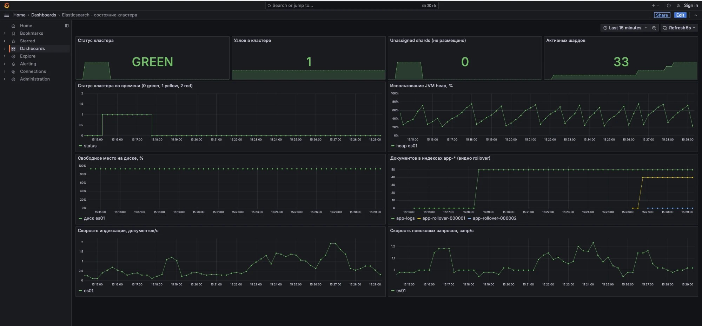

### Три метрики для алертов (`prometheus/alert.rules.yml`)

Из лекции в «мониторинг» вошли: состояние кластера, свободное место на диске, использование JVM heap, число unassigned shards. Для алертов мы взяли **три метрики**: статус кластера, heap и диск. Unassigned shards оставили на дашборде: это не отдельная беда, а объяснение жёлтого статуса, который уже ловит первая метрика.

**1. Статус кластера** (`ElasticsearchClusterYellow`, `ElasticsearchClusterRed`) — два правила на одну метрику.
- *yellow, warning, дольше 30 секунд*: первичные шарды размещены, а часть реплик нет. Данные доступны, но если узел с первичным шардом умрёт — копии нет. Именно этот алерт мы и наблюдали в части 1.
- *red, critical, дольше 10 секунд*: не размещён хотя бы один первичный шард — часть данных недоступна для поиска и записи. В это же правило включена ситуация «Elasticsearch вообще не отвечает» (`elasticsearch_node_stats_up == 0`): когда кластер лежит целиком, метрик про статус уже нет, и без этого условия алерт молчал бы именно тогда, когда нужнее всего.

**2. JVM heap > 85% дольше 2 минут** (`ElasticsearchHeapHigh`, warning). Тяжёлые агрегации и избыток шардов заполняют heap; дальше сборщик мусора работает всё чаще и дольше (запросы тормозят), затем возможен OutOfMemory и падение узла. 85% — это уже «пора вмешиваться», а не «упало»; `for: 2m`, чтобы не будить из-за коротких пиков.

**3. Свободного места на диске меньше 15% дольше 1 минуты** (`ElasticsearchDiskLow`, critical). 15% свободного — это ровно **low watermark** (85% занято): Elasticsearch перестаёт размещать на узле новые шарды. Ниже — high watermark (90%), а при 95% занятого (flood stage) все индексы узла переводятся в **read-only**, и запись прекращается, причём не только логов: у кластера один диск на всех. Это самая частая эксплуатационная авария Elasticsearch, поэтому алерт критический и стоит с запасом до flood stage.

В спокойном состоянии все правила `inactive`:

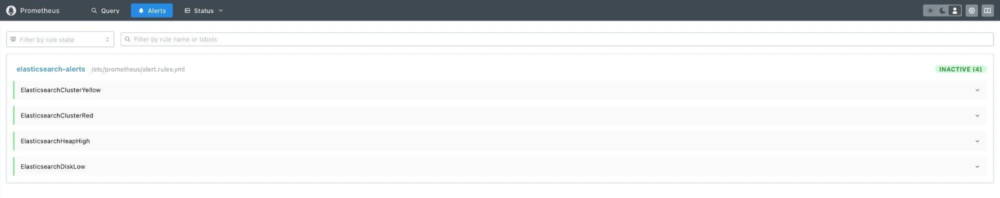

### Что будет, если Elasticsearch упадёт

Мы остановили контейнер (`docker compose stop elasticsearch`). Метрики кластера пропадают, `elasticsearch_node_stats_up` становится 0, и примерно через 30 секунд (скрейп, `for: 10s`) загорается `ElasticsearchClusterRed`. После `docker compose start elasticsearch` данные на месте (они лежат в томе), кластер снова green, алерт гаснет в течение ≈20 секунд.

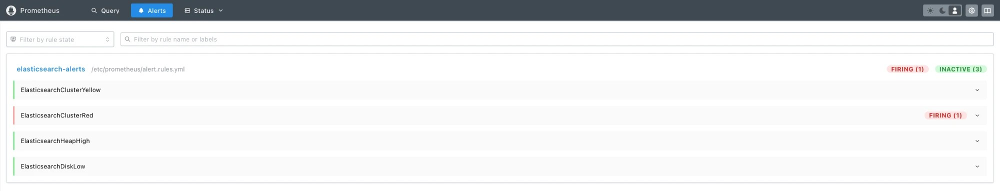

Alertmanager доставил уведомление на webhook:

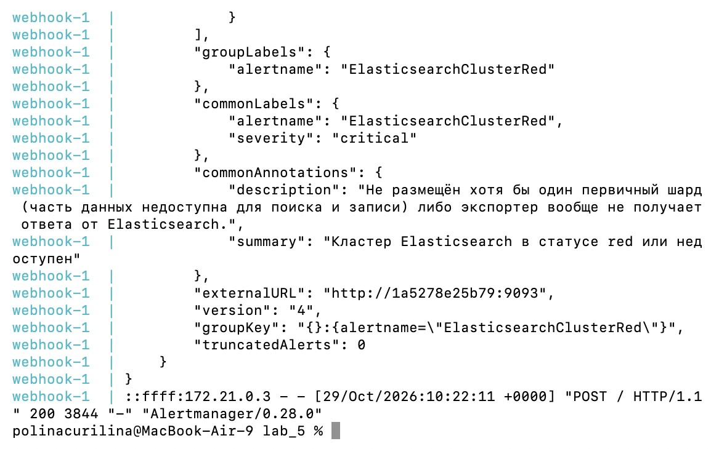

### Грабли мониторинга

- **Алерт «Elasticsearch недоступен» залипал после восстановления.** Сначала мы взяли метрику `elasticsearch_clusterinfo_up`. Но экспортер обновляет её не при каждом опросе, а раз в **5 минут** (отдельный коллектор «информации о кластере»): Elasticsearch давно поднялся и позеленел, а алерт всё горел. Заменили на `elasticsearch_node_stats_up`, которая обновляется на каждом скрейпе, — и алерт теперь гаснет сразу после восстановления.
- **`or vector(-1)` и метки в PromQL.** Тот же урок, что в лабах 3 и 4: `or` склеивает серии по набору меток, поэтому перед ним нужен `sum(...)`, который убирает метки. Иначе панель «Статус кластера» показывала бы два значения сразу.
- **Статус кластера приходит тремя метриками.** Экспортер отдаёт его не одним числом, а тремя метриками (`color="green|yellow|red"`, у текущего цвета значение 1, у остальных 0). Для панели мы свернули их в одно число: `yellow + 2*red` — 0 это green, 1 это yellow, 2 это red; значения подписаны через mapping в Grafana.

---

## Выводы

- **Статус кластера отражает не «данные целы», а «все ли копии шардов на месте».** На одном узле yellow — норма (реплике негде жить), но это же и объяснение, почему один узел — это не продакшен: green без реплик — это отсутствие отказоустойчивости, а не её наличие.
- **Тип поля решает всё.** `text` для поиска по словам, `keyword` для точных фильтров, `trace_id` и агрегаций. Перепутанный тип потом не исправить без переиндексации.
- **Фильтры и поиск по релевантности — разные вещи.** Для логов почти всегда нужен `filter` (без `_score`, с кешем), а `match` с релевантностью — для текстового поиска.
- **ILM нужен логам почти всегда.** Без ротации диск заполнится, а flood-stage переведёт в read-only весь узел, не только логи. Мы собрали ротацию из четырёх частей (политика, шаблон, первый индекс с alias, запись в alias) и увидели, что она работает без единого ручного действия.
- **Мониторить надо диск, heap и статус, и желательно с запасом.** Алерт, который срабатывает, когда уже read-only, бесполезен; поэтому порог по диску — low watermark (15% свободного), а не flood stage.

Чего не хватает для «взрослой» версии:
- кластер минимум из 3 узлов с настоящими репликами (и тогда статус green, а не yellow);
- включённая безопасность: TLS и пароли (мы выключали её ради удобства стенда);
- настоящий конвейер сбора логов: приложения → Filebeat/Logstash → Elasticsearch, вместо ручной заливки через Bulk API;
- data streams вместо alias + rollover (современный способ для логов);
- warm/cold-фазы ILM, перенос старых индексов на дешёвые узлы;
- резервные копии: snapshot/restore в объектное хранилище (S3), реплики их не заменяют;
- алерт на unassigned shards и рост числа шардов (oversharding).

---

## Про инструменты

Использовали: Docker Compose, Elasticsearch 8.15 и Kibana 8.15, elasticsearch-exporter, Prometheus, Alertmanager, Grafana. Генератор логов написан на Python (стандартная библиотека). Пользовались AI-ассистентом — для генерации скрипта и конфигов, подбора и отладки запросов и граблей, перечисленных выше, и для прогона всего сценария перед тем, как повторить его руками для скриншотов.
